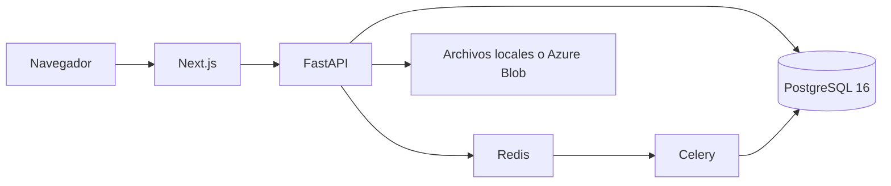

# CAPSTONE_2026_DUOC_ALAMEDA

**Nombre del proyecto:** Acredittia

**Descripción:** Plataforma web para que una empresa contratista arme, en un solo lugar, la carpeta de acreditación que le piden las faenas mineras: documentos de la empresa, del personal y de los equipos, con vigencias y alertas. No reemplaza las plataformas del mandante (SIGA, INTELICONTROL y otras). Ordena el trabajo de la contratista antes de cargar esos documentos allá.

Ingeniería informática, Duoc UC, sede Alameda. Portafolio de título 2026.

## Tecnologías utilizadas (lenguajes, frameworks, base de datos, cloud)

| Capa | Tecnología |
|---|---|
| Lenguajes | TypeScript y Python 3.12 |
| Interfaz | Next.js 14, React y Tailwind |
| API | FastAPI y SQLAlchemy 2 |
| Trabajos en segundo plano | Celery |
| Base de datos | PostgreSQL 16 |
| Cola | Redis 7 |
| Ambiente local | Docker Compose |
| Cloud | Frontend publicado en Vercel. Landing en Firebase Hosting. El diseño contempla Azure (PostgreSQL y Blob Storage). En local los archivos quedan en disco y la base corre en Docker. |

## Instrucciones para ejecutar el proyecto localmente

Requisito: Docker Desktop encendido.

```bash
git clone https://github.com/Njolul/ACREDITTIA-Desarrollo_FrontEND.git
cd ACREDITTIA-Desarrollo_FrontEND/app
docker compose up --build
```

- Aplicación: http://localhost:3000
- API y Swagger: http://localhost:8000/docs

La primera vez Docker crea la base con los scripts de `modelo_datos/` y carga faenas y plantillas de documentos.

Cuentas de prueba:

| Rol | Email | Contraseña |
|---|---|---|
| Administrador | admin@acredittia.cl | Admin2026! |
| Empresa demo | demo@acredittia.cl | Demo2026! |
| Empresa de prueba | prueba@dfd.cl | Prue123456 |

Para detener: `docker compose down` dentro de `app/`.

## Integrantes del equipo con sus roles

| Integrante | Rol |
|---|---|
| Diego Olvea | Modelo de datos y API (FastAPI, PostgreSQL) |
| Emmanuel Molina | Interfaz web (Next.js) |

## Metodología de trabajo del equipo (Scrum, Kanban, DevOps, etc.)

Scrum corto, en seis sprints de dos semanas. El alcance se cortó con MoSCoW: primero el circuito de acreditación (cuentas, contratos, personal, equipos, documentos y alertas). Pagos, conectores reales con las plataformas del mandante y el despliegue completo en Azure quedaron fuera de este corte.

El código está en GitHub. Cada entrega se probó contra la base local levantada con Docker. La API publica su contrato en Swagger (`/docs`).

## Arquitectura de la solución (descripción o diagrama)

El navegador habla con la aplicación Next.js. Esa aplicación llama a la API FastAPI. La API lee y escribe en PostgreSQL. Los trabajos que no pueden ir en el request (revisión de documentos y vencimientos) pasan por Redis y Celery. Los archivos subidos se guardan en disco en el ambiente local. El mismo flujo está pensado para Azure Blob cuando se despliegue en la nube.



Carpetas del repositorio:

- `app/` — producto: API, web y `docker-compose.yml`
- `modelo_datos/` — scripts SQL, del esquema a la migración 1.1
- `landing/` — sitio de presentación
- `admin/` — consola interna
- `docs/` — informes y evidencias de la asignatura

